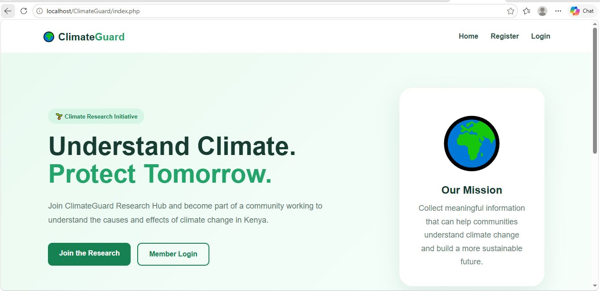
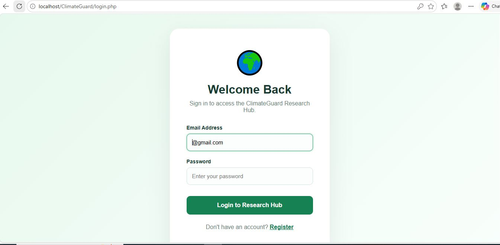
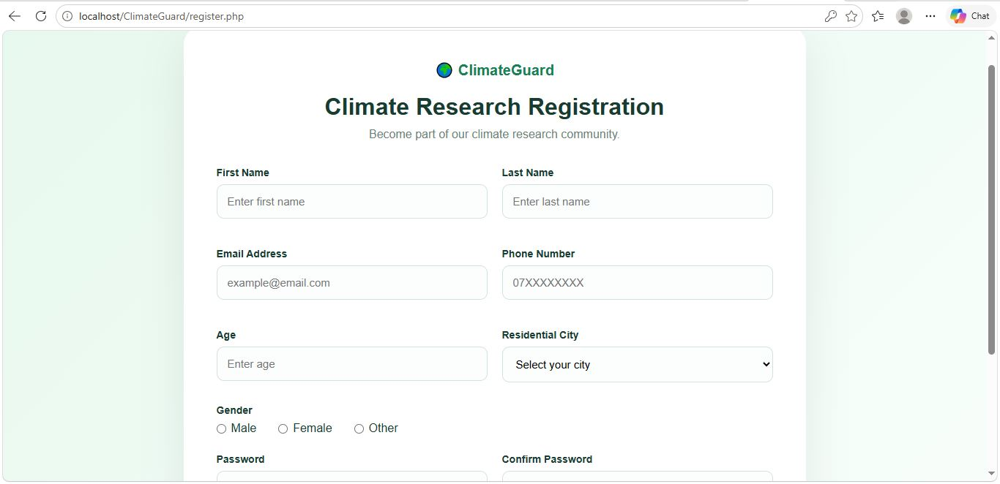

# Climate Guard 🌍

A PHP and MySQL web application developed to support climate awareness and provide a foundation for climate-related information and monitoring.

## 📌 Project Overview

Climate Guard is a web development project built using PHP, MySQL, HTML, and CSS. It demonstrates core web application concepts, including user registration, login, database connectivity, and a dashboard interface.

## ✨ Features

- User registration
- User login and logout
- Dashboard interface
- MySQL database connectivity
- PHP-based server-side functionality
- CSS styling
- Database connection error handling
- UTF-8 character support

## 🛠️ Technologies Used

- **PHP** — server-side application logic
- **MySQL** — database management
- **HTML** — web page structure
- **CSS** — styling and layout
- **XAMPP** — local Apache and MySQL development environment
- **Git and GitHub** — version control and project hosting

## 📂 Project Structure

```text
ClimateGuard/
├── dashboard.php
├── db.php
├── index.php
├── login.php
├── logout.php
├── register.php
├── style.css
├── .gitignore
└── README.md
```

## ⚙️ Requirements

Before running the project, install:

- [XAMPP](https://www.apachefriends.org/)
- A modern web browser
- A code editor such as Visual Studio Code

## 🚀 Installation and Setup

1. Install and open XAMPP.
2. Start **Apache** and **MySQL** from the XAMPP Control Panel.
3. Copy or clone this repository into your XAMPP `htdocs` directory.
4. Open phpMyAdmin at `http://localhost/phpmyadmin`.
5. Create a MySQL database named `climateguard_db`.
6. Configure the database connection in `db.php` to match your local MySQL settings.
7. Open the project in your browser using:

   `http://localhost/ClimateGuard/`

**Important:** The application may require database tables to be created before registration and login can work. Use the database schema associated with your project, if available.

## 🔐 Security Notes

- Do not commit passwords, API keys, or other secrets.
- Use a dedicated database user with a strong password outside local development.
- Store passwords securely using PHP password hashing functions.
- Validate and sanitize user input.
- Use prepared statements for database queries.
- Do not deploy the application publicly until authentication and database security have been reviewed.

## 🖼️ Screenshots

### Home Page


### Login Page


### Registration Page



## 🌐 Project Repository

[View Climate Guard on GitHub](https://github.com/LaurineOgutu-20/ClimateGuard)

## 👩‍💻 Developer

**Laurine Abong'o Ogutu**

ICT Technician student | PHP | MySQL | Web Development

---

This project is part of my practical learning journey in web development and database-driven applications.
