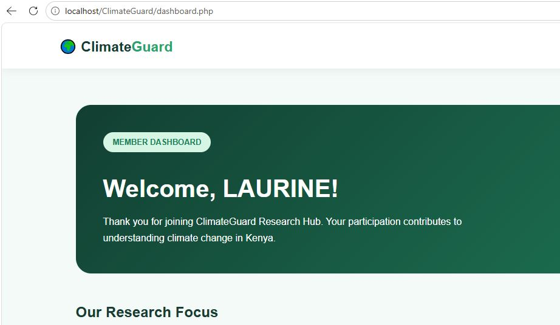

# 🌍 Climate Guard

A PHP and MySQL web application project focused on climate awareness and climate-related information.

[](https://www.php.net/)
[](https://www.mysql.com/)
[]()

## 🔗 Project Links

- **GitHub Repository:** [View Climate Guard Source Code](https://github.com/LaurineOgutu-20/ClimateGuard)
- **Live Website:** Coming soon — PHP hosting and online database setup are in progress.

## 📌 Project Overview

Climate Guard is a web application developed using PHP, MySQL, HTML, and CSS. The project demonstrates database-driven web development and user account functionality.

## ✨ Features

- User registration interface
- User login and logout
- Dashboard interface
- PHP server-side functionality
- MySQL database connectivity
- CSS-based page styling
- Database connection error handling
- UTF-8 character support

*Features should be tested before being considered production-ready.*


## 🖼️ Screenshots

### Home Page


### Login Page


### Registration Page


### Dashboard



## 🛠️ Technologies Used

- **PHP** — server-side programming
- **MySQL** — relational database
- **HTML** — page structure
- **CSS** — presentation and styling
- **XAMPP** — local development environment
- **Git and GitHub** — version control and source-code hosting

## 📂 Project Structure

```text
ClimateGuard/
├── screenshots/
│   ├── home.jpg
│   ├── login.jpg
│   └── register.jpg
├── dashboard.php
├── db.php
├── index.php
├── login.php
├── logout.php
├── register.php
├── style.css
├── .gitignore
└── README.md
```

## ⚙️ Run Locally

### Requirements

- XAMPP with Apache, PHP, and MySQL
- A web browser
- A code editor such as Visual Studio Code

### Setup Instructions

1. Start Apache and MySQL in the XAMPP Control Panel.
2. Place the project folder inside XAMPP's `htdocs` directory.
3. Open phpMyAdmin at `http://localhost/phpmyadmin`.
4. Create a database named `climateguard_db`.
5. Create the database tables required by the registration and login functionality.
6. Configure `db.php` with the appropriate local database connection settings.
7. Open the application at `http://localhost/ClimateGuard/`.

**Note:** The application requires the correct database tables and configuration to support registration and login.

## 🔐 Security Considerations

Before public deployment:

- Never publish real passwords, secrets, or private user information.
- Use strong database credentials and secure production configuration.
- Hash passwords using PHP's password-hashing functions.
- Use prepared SQL statements to help prevent SQL injection.
- Validate user input and escape output appropriately.
- Protect authenticated pages and session handling.
- Test registration, login, logout, and access controls.

## 🚀 Deployment

The application is being prepared for deployment to a PHP-compatible hosting provider with MySQL support.

GitHub hosts the source code, but GitHub Pages does not execute PHP or provide a MySQL server for this application.

The public website link will be added here once deployment and online testing are complete.

## 👩‍💻 Developer

**Laurine Abong'o Ogutu**

ICT Technician Student | PHP | MySQL | Web Development

## 📄 License

No license has been specified yet. Contact the repository owner before reusing this project.

---

*Built as part of a practical web development and database application learning journey.*
